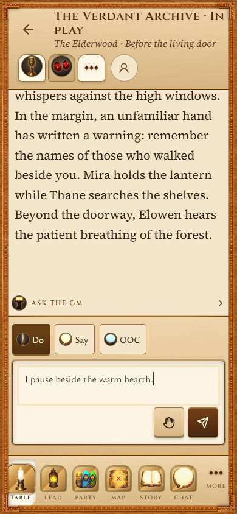
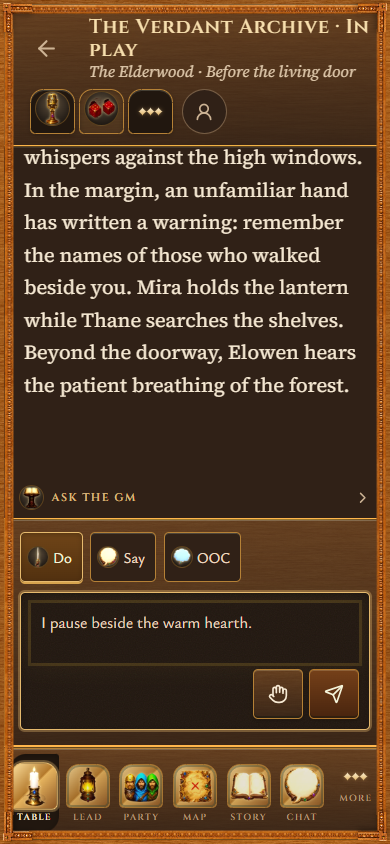
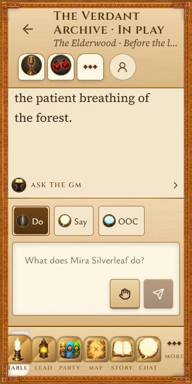
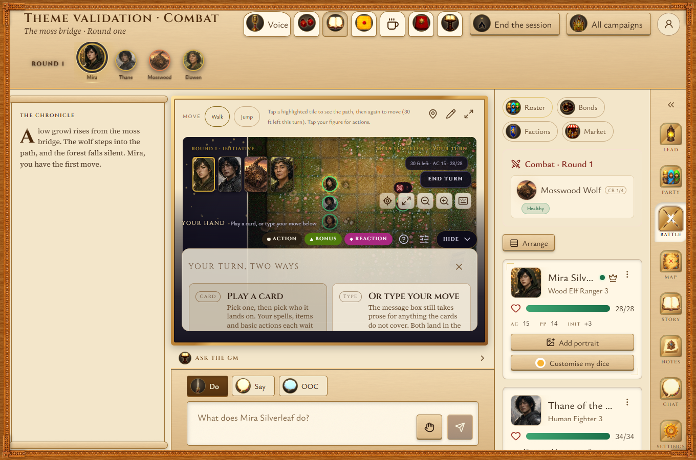
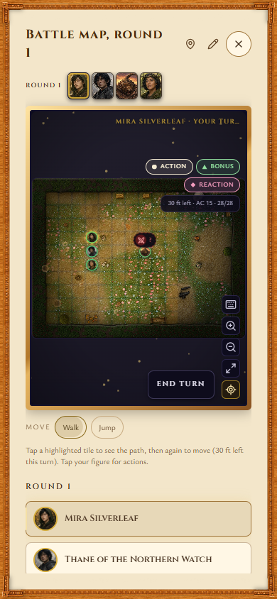
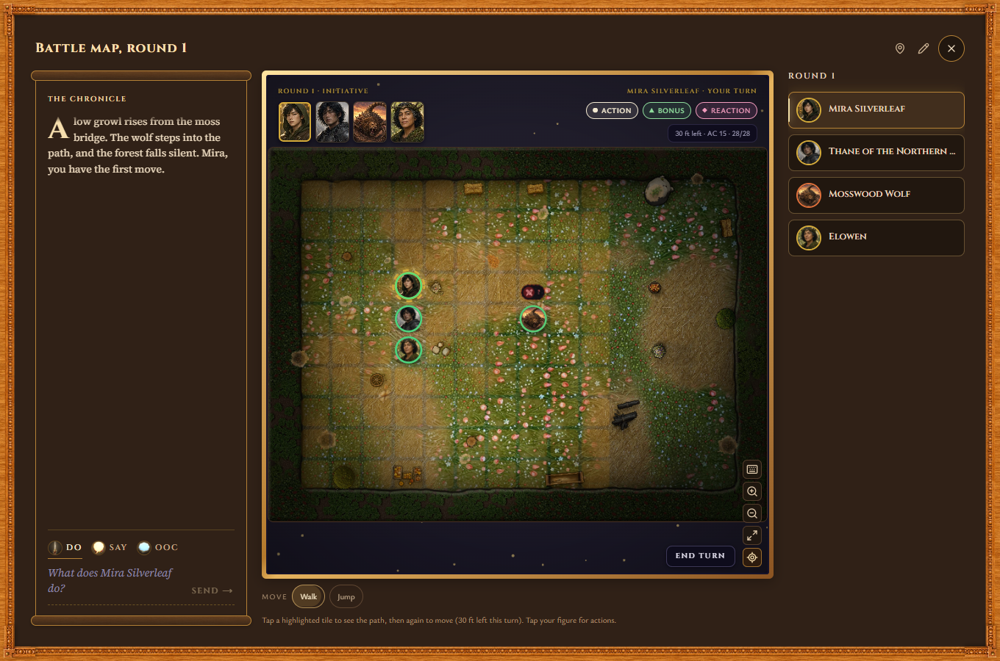
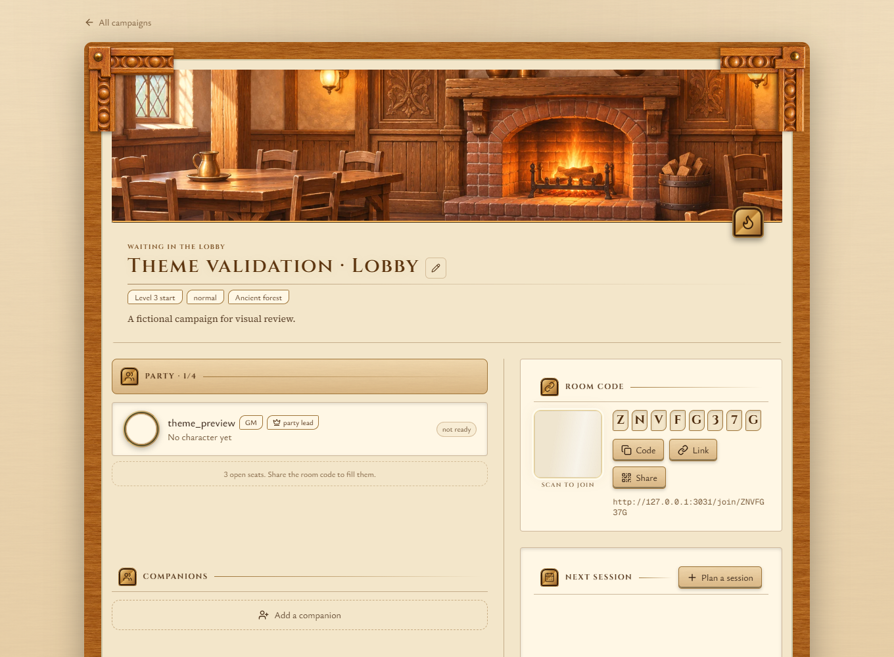
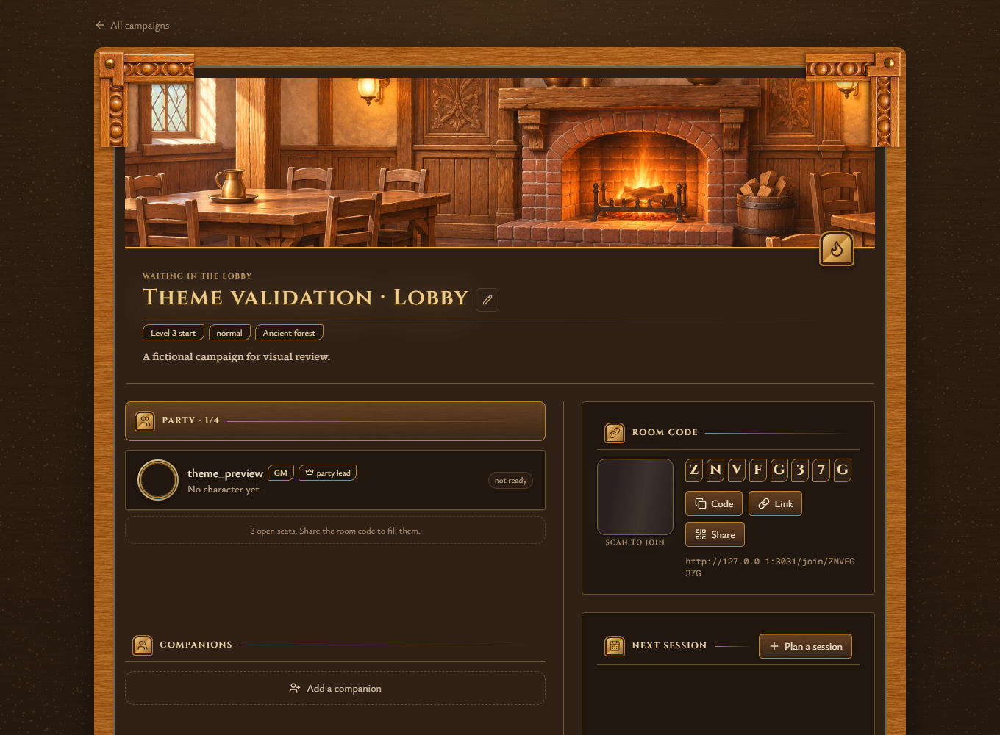

# Hearth & Haven corrected production review

Source: `18c309c6fef99adbb07f29886cbd6769eeb97d92` on
`codex/hearth-haven-theme`, integrating PR 962 at `fccee2be4`.
Captured 2026-11-14 (America/Toronto). [Draft PR 967](https://github.com/Lebbitheplow/open-game-master/pull/967).

The shared header hooks replace Hearth's positional workaround. Send and the
moving selected-mode highlight now use oak/amber materials. The hand-label fix
and original art remain. The map's content clears its painted rail.

## Validation

- Appearance checks: 12 catalog + 5 contracts passed.
- Full lint: 0 errors, 313 existing warnings. Production build and TypeScript passed.
- Existing bundle budgets passed: shared CSS 107.5 KiB, rulebook CSS 114.1 KiB.
- [Expanded production matrix](corrections/results-production.json): 59 passed, 0 failed.
- [Hearth readability](corrections/results-hearth-readability.json): 20 passed, including actual enabled Send and moving-highlight contrast (7.50:1 / 7.36:1 minimum in both modes).
- [Shared browser investigation](corrections/results-shared-investigation.json): 6/9 passed; name-menu desktop/phone contrast and day-board desktop gradient assertion remain failing. Travel and table arrangement pass.
- [CI failure comparison](corrections/ci-failure-comparison.json): 15/16 earlier Hearth failures are identical to failures on the original shared base before Hearth existed.
- [Machine-readable validation summary](corrections/checks.json).

These results do not clear the shared failures or final CI. Native app-shell,
real-phone/mobile Safari and screen-reader reviews remain. All campaign data
are fictional; any loopback join address belongs to the disposable preview.
No private campaign data, credentials or browser profiles are included.

Only `corrections/` contains the current source's captures and results. The
older root images and JSON are retained as historical evidence of earlier
commits, and must not be read as validation of this correction.

## Reviewed views

## All 48 refreshed screenshots

- [validation-picker-1360-dark-1.png](corrections/images/validation-picker-1360-dark-1.png)
- [validation-picker-1360-light-1.png](corrections/images/validation-picker-1360-light-1.png)
- [validation-picker-390-dark-1.png](corrections/images/validation-picker-390-dark-1.png)
- [validation-picker-390-light-1.png](corrections/images/validation-picker-390-light-1.png)
- [validation-picker-320-light-1.25.png](corrections/images/validation-picker-320-light-1.25.png)
- [validation-picker-layout-4.png](corrections/images/validation-picker-layout-4.png)
- [validation-picker-layout-6.png](corrections/images/validation-picker-layout-6.png)
- [validation-header-story-320-dark-large.png](corrections/images/validation-header-story-320-dark-large.png)
- [validation-header-story-390-dark-large.png](corrections/images/validation-header-story-390-dark-large.png)
- [validation-header-combat-1024-dark-large.png](corrections/images/validation-header-combat-1024-dark-large.png)
- [validation-header-combat-1360-dark-large.png](corrections/images/validation-header-combat-1360-dark-large.png)
- [validation-header-combat-1920-dark-large.png](corrections/images/validation-header-combat-1920-dark-large.png)
- [validation-frame-clearance-390-dark.png](corrections/images/validation-frame-clearance-390-dark.png)
- [validation-frame-clearance-1360-dark.png](corrections/images/validation-frame-clearance-1360-dark.png)
- [validation-header-story-320-light-large.png](corrections/images/validation-header-story-320-light-large.png)
- [validation-header-story-390-light-large.png](corrections/images/validation-header-story-390-light-large.png)
- [validation-header-combat-1024-light-large.png](corrections/images/validation-header-combat-1024-light-large.png)
- [validation-header-combat-1360-light-large.png](corrections/images/validation-header-combat-1360-light-large.png)
- [validation-header-combat-1920-light-large.png](corrections/images/validation-header-combat-1920-light-large.png)
- [validation-frame-clearance-390-light.png](corrections/images/validation-frame-clearance-390-light.png)
- [validation-frame-clearance-1360-light.png](corrections/images/validation-frame-clearance-1360-light.png)
- [validation-lobby-1360-dark.png](corrections/images/validation-lobby-1360-dark.png)
- [validation-lobby-1360-light.png](corrections/images/validation-lobby-1360-light.png)
- [validation-lobby-390-dark.png](corrections/images/validation-lobby-390-dark.png)
- [validation-lobby-390-light.png](corrections/images/validation-lobby-390-light.png)
- [validation-story-1360-dark-large.png](corrections/images/validation-story-1360-dark-large.png)
- [validation-story-1360-light-large.png](corrections/images/validation-story-1360-light-large.png)
- [validation-story-390-dark-large.png](corrections/images/validation-story-390-dark-large.png)
- [validation-story-390-light-large.png](corrections/images/validation-story-390-light-large.png)
- [validation-dice-dark-large.png](corrections/images/validation-dice-dark-large.png)
- [validation-dice-light-large.png](corrections/images/validation-dice-light-large.png)
- [validation-combat-1360-dark-large.png](corrections/images/validation-combat-1360-dark-large.png)
- [validation-combat-1360-light-large.png](corrections/images/validation-combat-1360-light-large.png)
- [validation-combat-390-dark-large.png](corrections/images/validation-combat-390-dark-large.png)
- [validation-combat-hand-dark-large.png](corrections/images/validation-combat-hand-dark-large.png)
- [validation-combat-390-light-large.png](corrections/images/validation-combat-390-light-large.png)
- [validation-combat-hand-light-large.png](corrections/images/validation-combat-hand-light-large.png)
- [validation-map-enlarged.png](corrections/images/validation-map-enlarged.png)
- [validation-map-enlarged-390-dark.png](corrections/images/validation-map-enlarged-390-dark.png)
- [validation-map-enlarged-390-light.png](corrections/images/validation-map-enlarged-390-light.png)
- [validation-map-enlarged-1360-light.png](corrections/images/validation-map-enlarged-1360-light.png)
- [validation-combat-card.png](corrections/images/validation-combat-card.png)
- [validation-picker-hearth-320-light.png](corrections/images/validation-picker-hearth-320-light.png)
- [validation-picker-hearth-320-dark.png](corrections/images/validation-picker-hearth-320-dark.png)
- [validation-hearth-header-story-light.png](corrections/images/validation-hearth-header-story-light.png)
- [validation-hearth-header-story-dark.png](corrections/images/validation-hearth-header-story-dark.png)
- [validation-hearth-header-combat-light.png](corrections/images/validation-hearth-header-combat-light.png)
- [validation-hearth-header-combat-dark.png](corrections/images/validation-hearth-header-combat-dark.png)
