# Hearth & Haven visual review

Original crafted-oak, amber and parchment treatment for Open Game Master.
Source: `codex/hearth-haven-theme`, implementation commit
`11ddc89e20c7913c7a79c4ffaf986b566ee9f6ad`, dependent on PR 962.

Captured 2026-11-14 with the repository's disposable browser fixture. All
campaigns and characters are fictional. The loopback join address in lobby
captures belongs only to the disposable local preview.

The development and production browser matrices each passed all 43 checks, including 320/390px phone
layouts, text at 125%, keyboard interactions, picker isolation, theme switching,
transparent decorative overlays and forced-colors hiding. Results are preserved
in `results-development.json` and `results-production.json`. The displayed images
are the final production captures. Commit `0444b31` preserves the initial development
captures at source `2b8156579`; commit `b743626` preserves that source's production
captures before the phone readability corrections. This gallery is separate from application source.
Native app shells, real devices/mobile Safari and screen readers still need review.

The final source also passed 18 focused readability checks in
`results-hearth-readability.json`: separate Back/title columns at 320/390px,
day/night and 100%/125% text, plus a bright player-hand label over the dark map.
The phone-header regression failed on the previous build before the fix.

## Picker

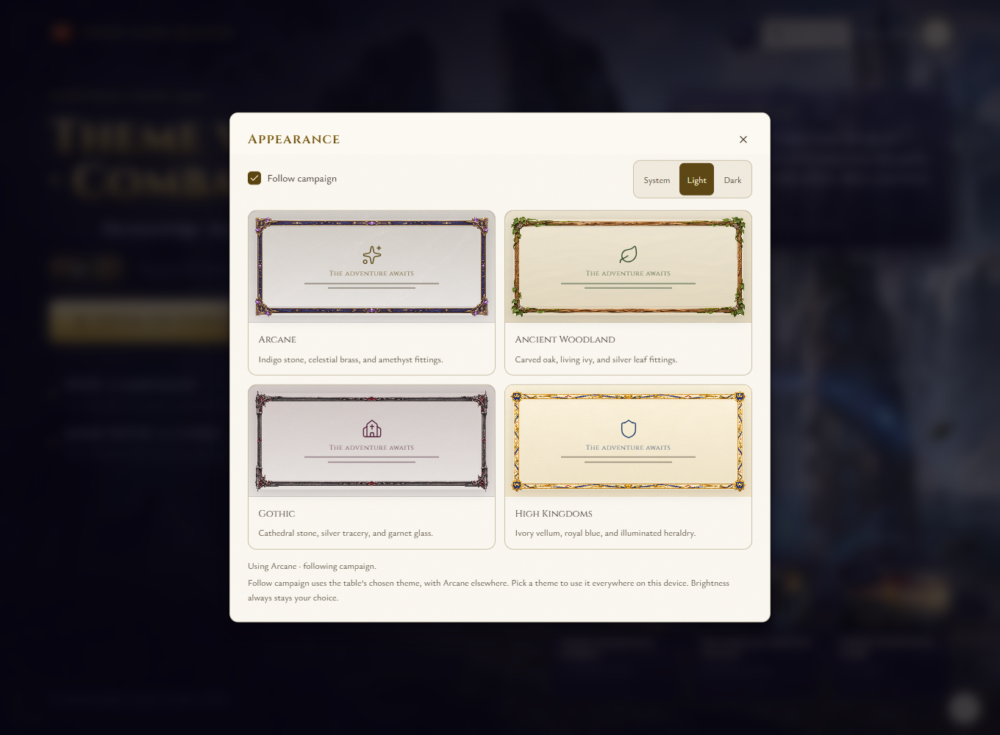

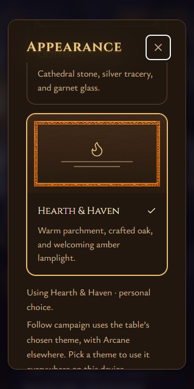

## Lobby

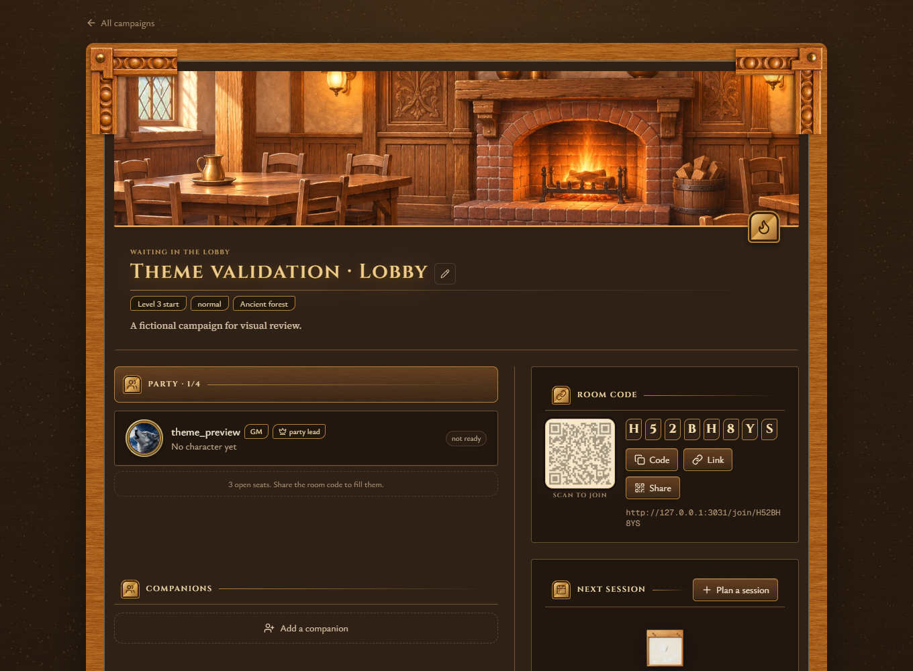
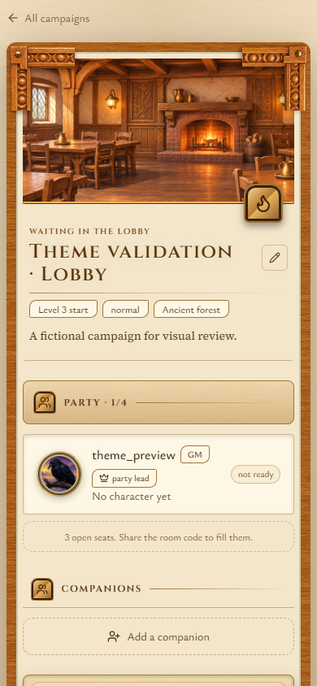

## Story and combat

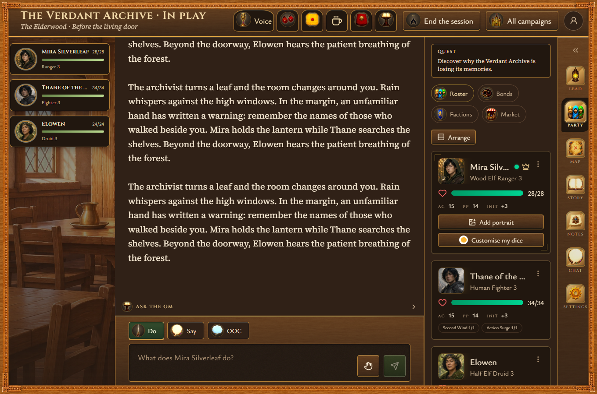

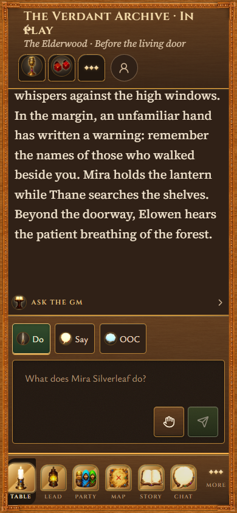
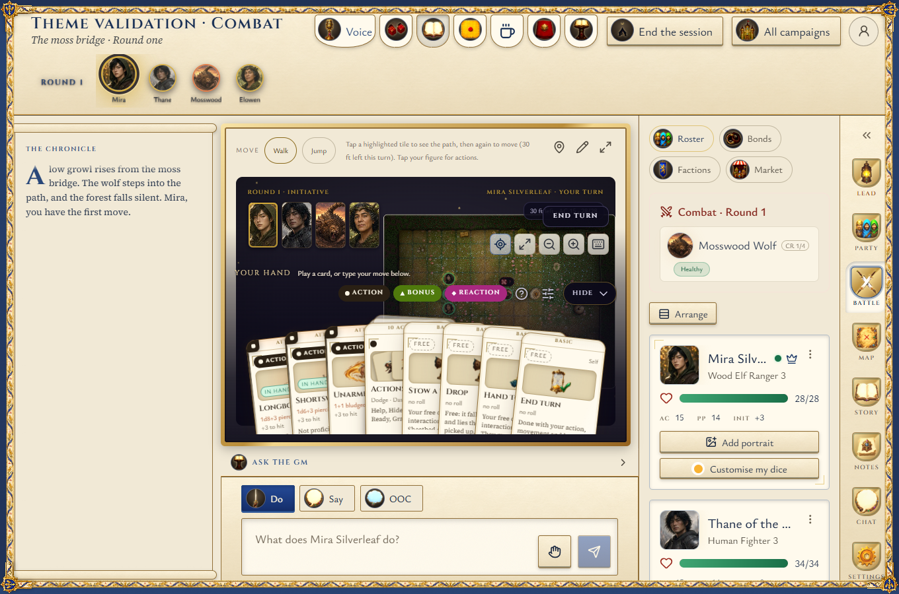

## Enlarged map and dialogs

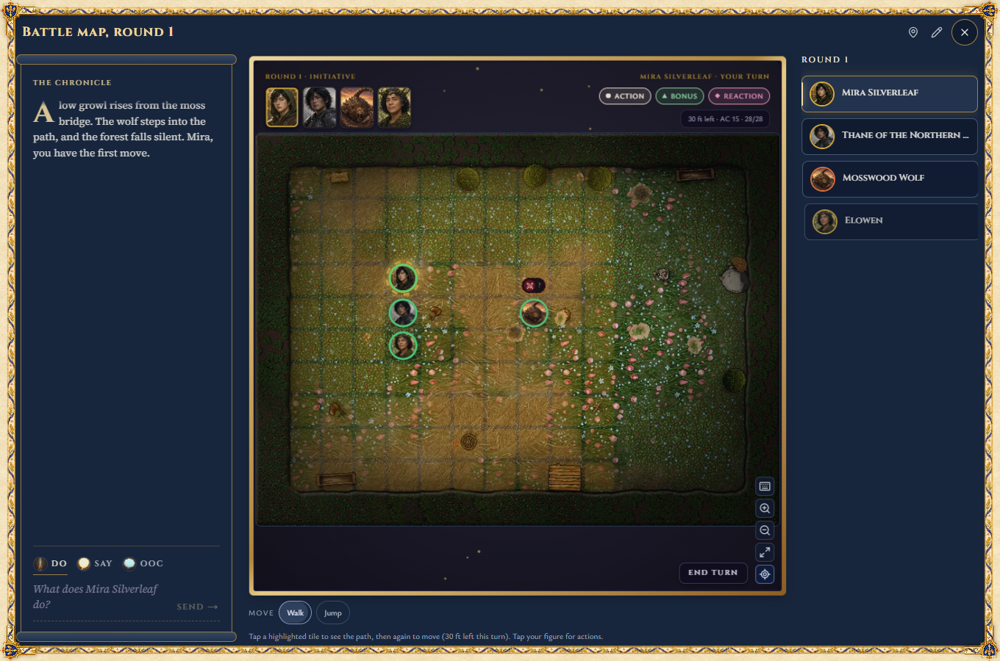
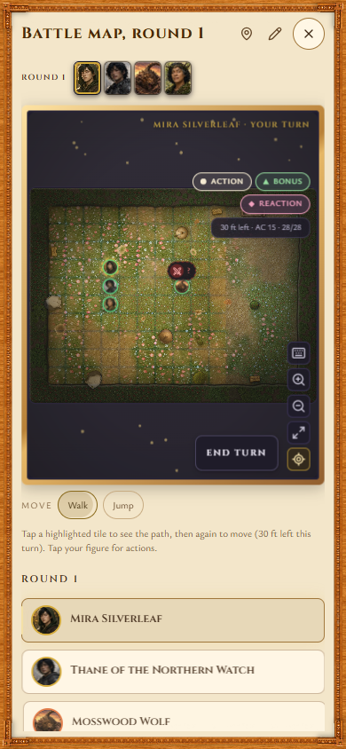

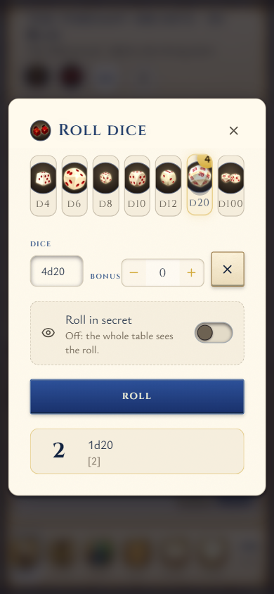
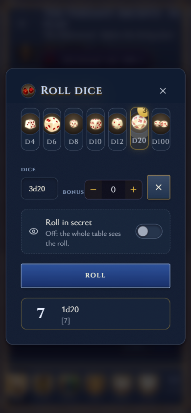

The remaining images include the keyboard-selected combat card, phone hand and
four/six-choice layout fixtures. The theme adds no gameplay behavior or genre default.

## Check status at handoff

`checks-at-handoff.json` preserves a timestamped snapshot for published commit
`ee8af415cd0ccbbb83b856f16209a46103c189ce` (final implementation `11ddc89e2`).
Both Linux and Windows CI builds passed. The full test and browser shards were
still running, so the draft does not claim a full-suite CI pass.

Local appearance contracts, lint, production build/budgets, 43 production
browser checks and 18 readability checks passed. The broader local audit was
stopped in favor of the complete CI runs: 428 distinct files had passing
results out of 1,218. Files that encountered direct-run TSX/ESM incompatibilities
or timeouts were not counted as passes. An initial narrator-suite failure passed
an isolated rerun with 63 checks. CI, native-shell and real-device review remain
visible delivery work; nothing was merged.
