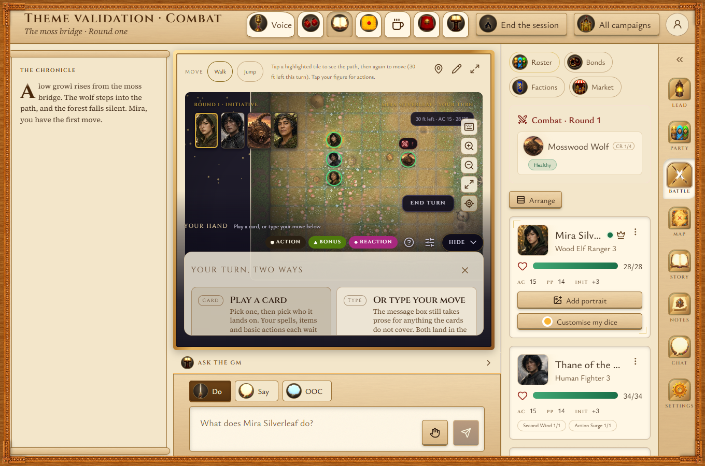
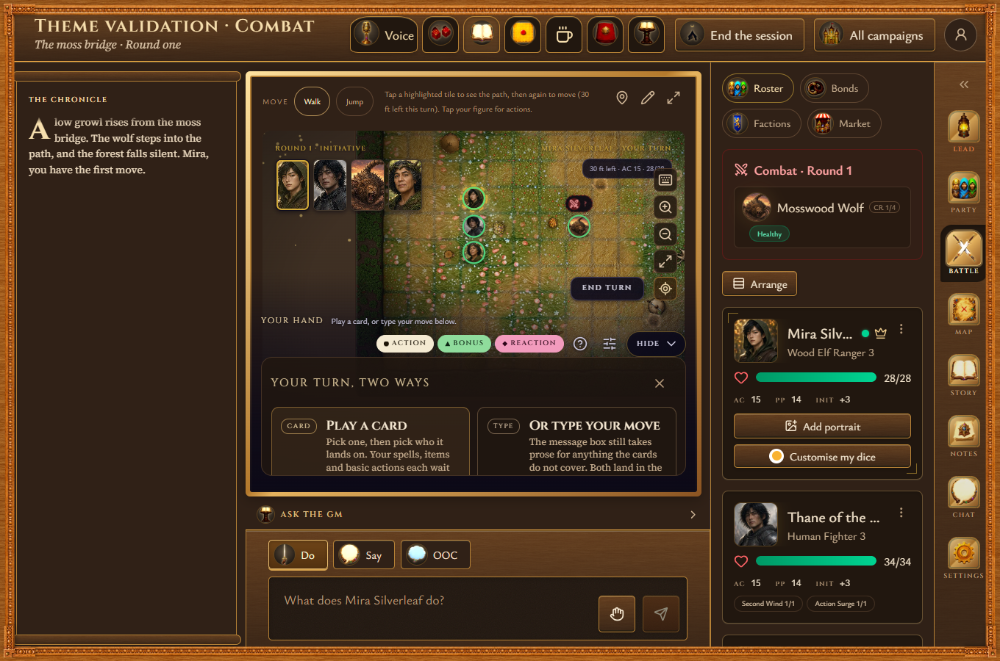
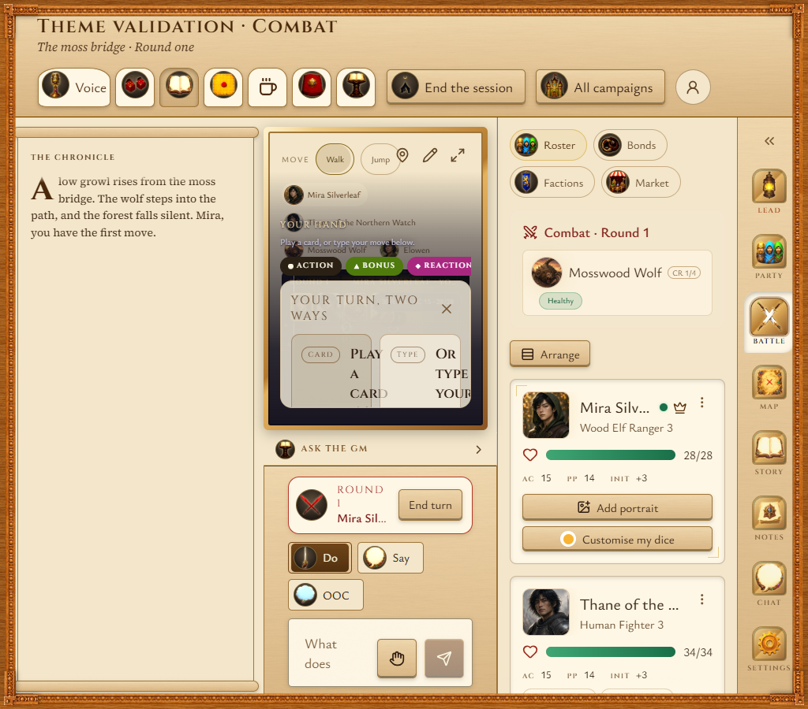
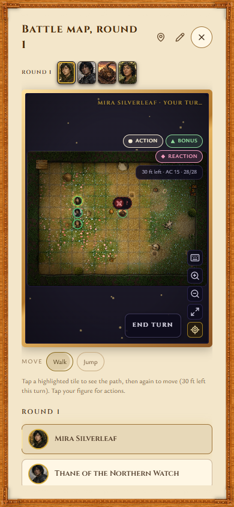
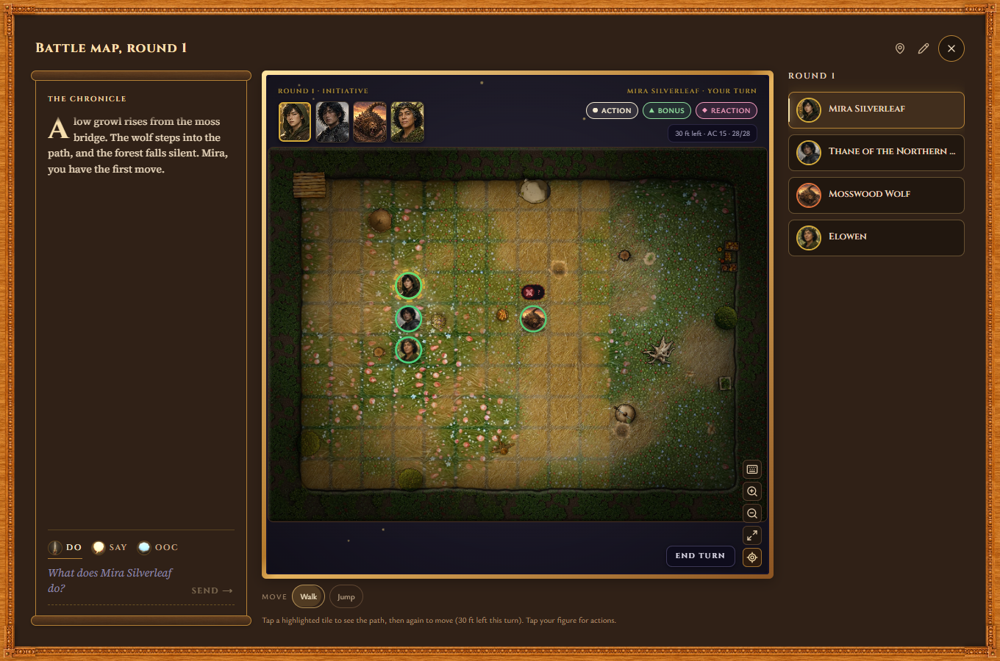
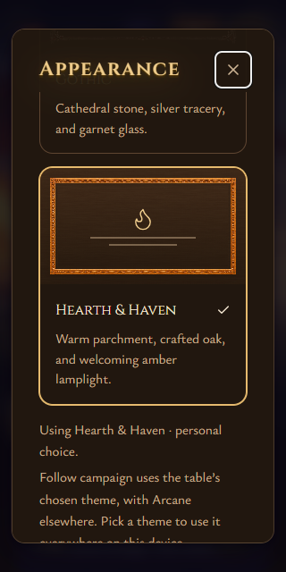

# Hearth & Haven: shared CI fixes integrated

Source `d0f70d3b37779dc9635ef65f2640bb818a60d957` integrates PR 962 at `cab3070dc96c895a1d8aae8d6dd34b05c1a6ef65`.
[Draft PR 967](https://github.com/Lebbitheplow/open-game-master/pull/967).
Captured 2026-11-15 (America/Toronto), using disposable fictional campaigns.

Hearth's artwork, palettes, oak action colors, flame icon and map-hand label fix
are unchanged. The shared update fixes label contrast, foe-card border meaning,
laptop map space and the empty ornament container's interference with axe.
The painted rails and corners stay visible. No duplicate theme-specific fixes
were added.

## Current validation

- Appearance checks: 12 catalog + 5 contracts passed.
- Four targeted component suites passed: adventuring gear, builder gear, builder reselect and possessive title case.
- Full lint: 0 errors, 313 existing warnings. Production build and TypeScript passed.
- Existing bundle budgets passed: shared CSS 107.5 KiB, rulebook CSS 114.1 KiB, JavaScript unchanged.
- [Hearth production matrix](ci-fixes/results-production.json): 59/59, including visible frame and corner assertions.
- [Hearth readability checks](ci-fixes/results-hearth-readability.json): 20/20, including enabled Send and the actual moving selected-mode fill.
- [Shared browser cases](ci-fixes/results-shared-browser.json): 21/21 in one production run. This covers name menus, day boards, narration accessibility, companion allegiance, hand-on-board, builder accessibility, spell/identity steps, sheets and both fight benches. These general fixtures use their default appearance.
- [Validation summary](ci-fixes/checks.json).

The earlier 6/9 result and inherited blockers belong to the preceding source.
The selected cases now pass on this integrated build. This does not claim a full
local repository-suite pass or final GitHub CI clearance. Native app-shell,
real-device/mobile Safari and screen-reader review remain outstanding.

## Remaining shared layout limitation

At 1024 × 900 with 125% text and both side panels open, the combat board is only
238 × 172.5px and the hand overlays most of it. The header is readable, so the
header regression passes; it does not assert board usability at that width.
After dismissing the tutorial and settling animations, Hearth and Arcane have
identical measured geometry. This is a shared follow-up, not a new theme override.
[Measurements](ci-fixes/narrow-combat-observation.json),
[Hearth view](ci-fixes/images/validation-narrow-combat-hearth.png),
[Arcane view](ci-fixes/images/validation-narrow-combat-arcane.png).

Current evidence is exclusively under `ci-fixes/`. Older root files and
`corrections/` remain historical evidence. No databases, browser profiles,
credentials or real player data are included. Lobby loopback addresses belong
only to the disposable fixture.

## Reviewed views

## All 50 refreshed screenshots

- [validation-picker-1360-dark-1.png](ci-fixes/images/validation-picker-1360-dark-1.png)
- [validation-picker-1360-light-1.png](ci-fixes/images/validation-picker-1360-light-1.png)
- [validation-picker-390-dark-1.png](ci-fixes/images/validation-picker-390-dark-1.png)
- [validation-picker-390-light-1.png](ci-fixes/images/validation-picker-390-light-1.png)
- [validation-picker-320-light-1.25.png](ci-fixes/images/validation-picker-320-light-1.25.png)
- [validation-picker-layout-4.png](ci-fixes/images/validation-picker-layout-4.png)
- [validation-picker-layout-6.png](ci-fixes/images/validation-picker-layout-6.png)
- [validation-header-story-320-dark-large.png](ci-fixes/images/validation-header-story-320-dark-large.png)
- [validation-header-story-390-dark-large.png](ci-fixes/images/validation-header-story-390-dark-large.png)
- [validation-header-combat-1024-dark-large.png](ci-fixes/images/validation-header-combat-1024-dark-large.png)
- [validation-header-combat-1360-dark-large.png](ci-fixes/images/validation-header-combat-1360-dark-large.png)
- [validation-header-combat-1920-dark-large.png](ci-fixes/images/validation-header-combat-1920-dark-large.png)
- [validation-frame-clearance-390-dark.png](ci-fixes/images/validation-frame-clearance-390-dark.png)
- [validation-frame-clearance-1360-dark.png](ci-fixes/images/validation-frame-clearance-1360-dark.png)
- [validation-header-story-320-light-large.png](ci-fixes/images/validation-header-story-320-light-large.png)
- [validation-header-story-390-light-large.png](ci-fixes/images/validation-header-story-390-light-large.png)
- [validation-header-combat-1024-light-large.png](ci-fixes/images/validation-header-combat-1024-light-large.png)
- [validation-header-combat-1360-light-large.png](ci-fixes/images/validation-header-combat-1360-light-large.png)
- [validation-header-combat-1920-light-large.png](ci-fixes/images/validation-header-combat-1920-light-large.png)
- [validation-frame-clearance-390-light.png](ci-fixes/images/validation-frame-clearance-390-light.png)
- [validation-frame-clearance-1360-light.png](ci-fixes/images/validation-frame-clearance-1360-light.png)
- [validation-lobby-1360-dark.png](ci-fixes/images/validation-lobby-1360-dark.png)
- [validation-lobby-1360-light.png](ci-fixes/images/validation-lobby-1360-light.png)
- [validation-lobby-390-dark.png](ci-fixes/images/validation-lobby-390-dark.png)
- [validation-lobby-390-light.png](ci-fixes/images/validation-lobby-390-light.png)
- [validation-story-1360-dark-large.png](ci-fixes/images/validation-story-1360-dark-large.png)
- [validation-story-1360-light-large.png](ci-fixes/images/validation-story-1360-light-large.png)
- [validation-story-390-dark-large.png](ci-fixes/images/validation-story-390-dark-large.png)
- [validation-story-390-light-large.png](ci-fixes/images/validation-story-390-light-large.png)
- [validation-dice-dark-large.png](ci-fixes/images/validation-dice-dark-large.png)
- [validation-dice-light-large.png](ci-fixes/images/validation-dice-light-large.png)
- [validation-combat-1360-dark-large.png](ci-fixes/images/validation-combat-1360-dark-large.png)
- [validation-combat-1360-light-large.png](ci-fixes/images/validation-combat-1360-light-large.png)
- [validation-combat-390-dark-large.png](ci-fixes/images/validation-combat-390-dark-large.png)
- [validation-combat-hand-dark-large.png](ci-fixes/images/validation-combat-hand-dark-large.png)
- [validation-combat-390-light-large.png](ci-fixes/images/validation-combat-390-light-large.png)
- [validation-combat-hand-light-large.png](ci-fixes/images/validation-combat-hand-light-large.png)
- [validation-map-enlarged.png](ci-fixes/images/validation-map-enlarged.png)
- [validation-map-enlarged-390-dark.png](ci-fixes/images/validation-map-enlarged-390-dark.png)
- [validation-map-enlarged-390-light.png](ci-fixes/images/validation-map-enlarged-390-light.png)
- [validation-map-enlarged-1360-light.png](ci-fixes/images/validation-map-enlarged-1360-light.png)
- [validation-combat-card.png](ci-fixes/images/validation-combat-card.png)
- [validation-picker-hearth-320-light.png](ci-fixes/images/validation-picker-hearth-320-light.png)
- [validation-picker-hearth-320-dark.png](ci-fixes/images/validation-picker-hearth-320-dark.png)
- [validation-narrow-combat-hearth.png](ci-fixes/images/validation-narrow-combat-hearth.png)
- [validation-narrow-combat-arcane.png](ci-fixes/images/validation-narrow-combat-arcane.png)
- [validation-hearth-header-story-light.png](ci-fixes/images/validation-hearth-header-story-light.png)
- [validation-hearth-header-story-dark.png](ci-fixes/images/validation-hearth-header-story-dark.png)
- [validation-hearth-header-combat-light.png](ci-fixes/images/validation-hearth-header-combat-light.png)
- [validation-hearth-header-combat-dark.png](ci-fixes/images/validation-hearth-header-combat-dark.png)
