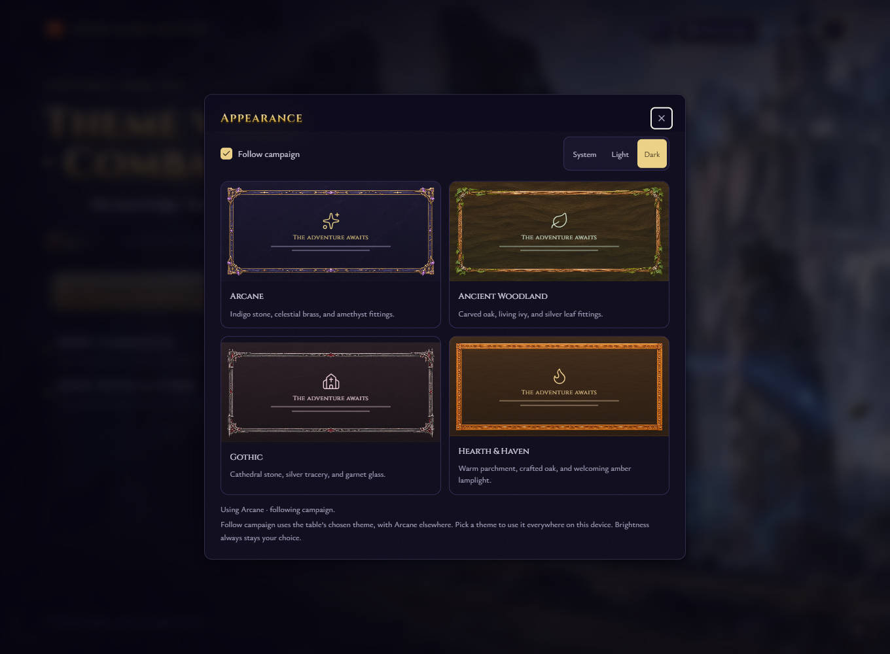
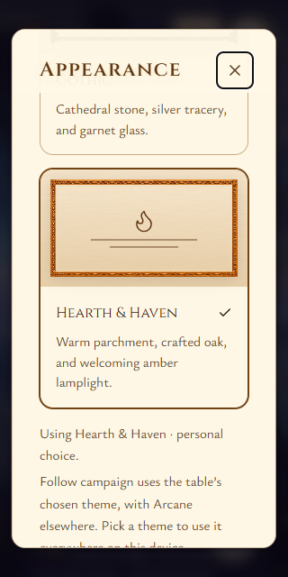
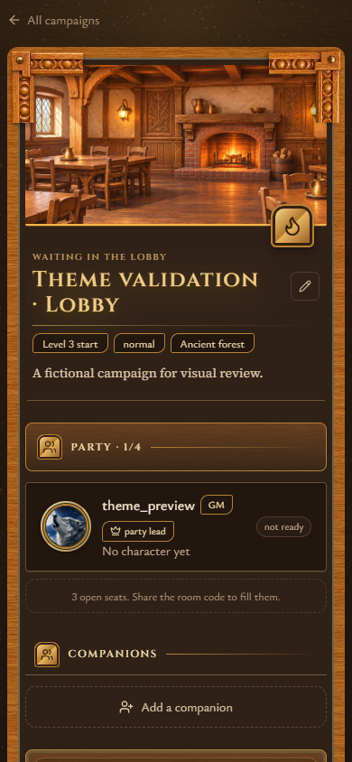
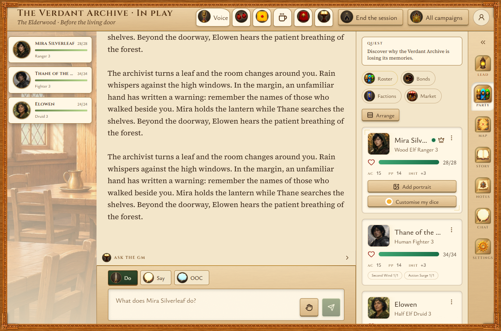
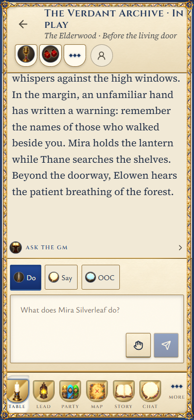
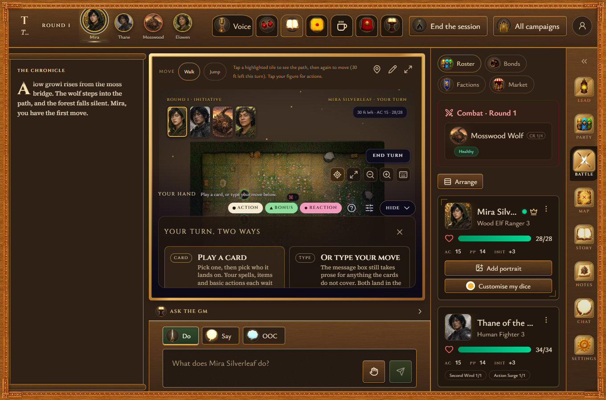
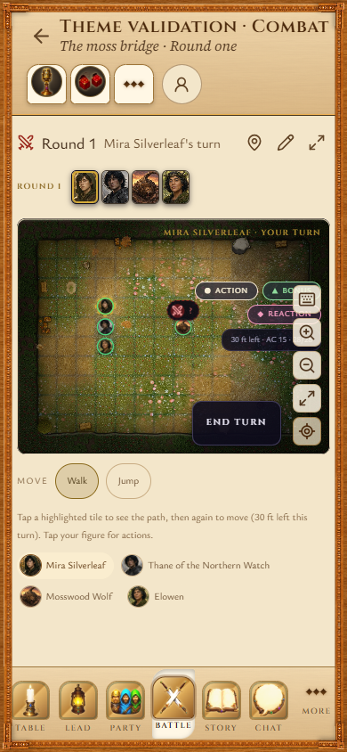
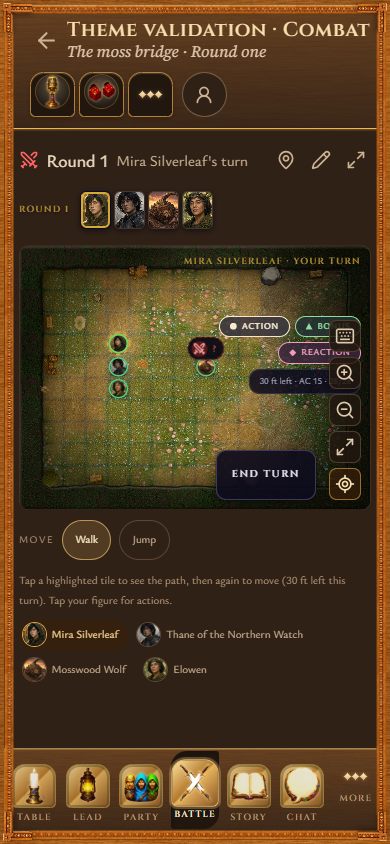
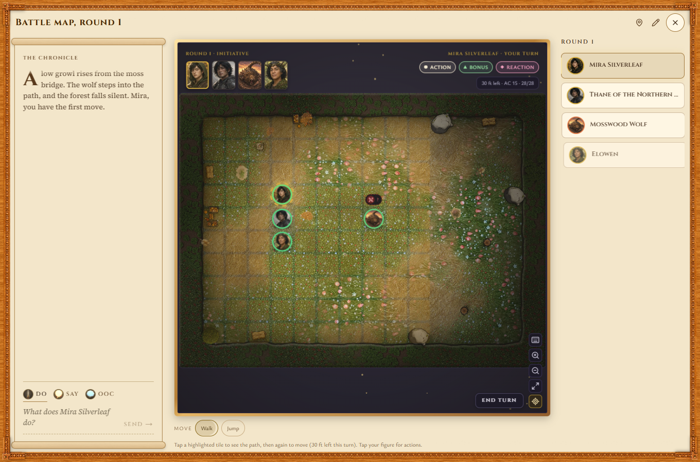
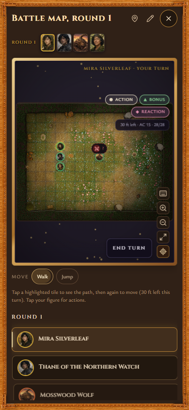

# Hearth & Haven visual review

Original crafted-oak, amber and parchment treatment for Open Game Master.
Source: `codex/hearth-haven-theme`, implementation commit
`2b815657967915c4eaf222cd6242425bcd118298`, dependent on PR 962.

Captured 2026-11-14 with the repository's disposable browser fixture. All
campaigns and characters are fictional. The loopback join address in lobby
captures belongs only to the disposable local preview.

The development and production browser matrices each passed all 43 checks, including 320/390px phone
layouts, text at 125%, keyboard interactions, picker isolation, theme switching,
transparent decorative overlays and forced-colors hiding. Results are preserved
in `results-development.json` and `results-production.json`. The displayed images
are the final production captures; the preceding commit preserves the development
captures. This gallery is separate from application source.
Native app shells, real devices/mobile Safari and screen readers still need review.

## Picker

## Lobby

## Story and combat

## Enlarged map and dialogs

The remaining images include the keyboard-selected combat card, phone hand and
four/six-choice layout fixtures. The theme adds no gameplay behavior or genre default.
